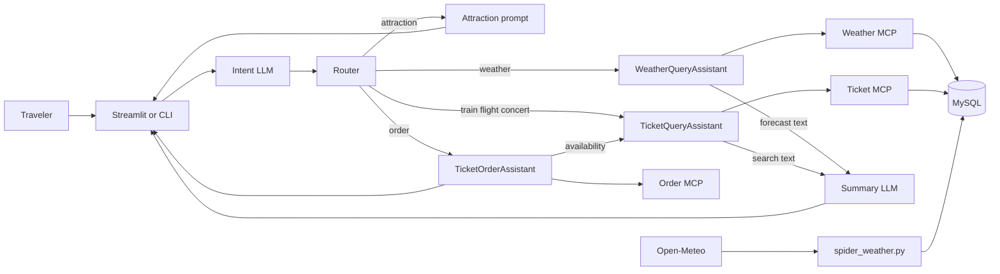

# SmartVoyage

SmartVoyage is a travel assistant for Australian city trips. A traveler asks in plain English for a forecast, a fare, a booking, or a place to visit. The application classifies the request, sends it to the specialist that owns that task, and returns a short answer in the same conversation.

The chat is a Streamlit page (`app.py`). The same routing also runs from the command line (`main.py`). Weather, tickets, and booking are separate Agent-to-Agent services. Place suggestions come from the language model and are not loaded from a table.

## Key Features

- **Intent routing.** The latest turn, a short slice of conversation history, and the current date in Australia/Sydney go to an intent prompt. The model returns JSON with `intents`, a rewritten query per intent, and an optional follow-up. Recognized intents are `weather`, `train`, `flight`, `concert`, `order`, and `attraction`. One message can be split across more than one specialist.
- **Weather forecasts.** `WeatherQueryAssistant` turns the conversation into a `SELECT` on `weather_data`, reads the rows through a weather MCP tool, and returns city, date, conditions, temperature, humidity, wind, and precipitation. The UI rewrites that text into a short forecast.
- **Ticket search.** `TicketQueryAssistant` writes a `SELECT` for trains, flights, or concerts, reads the rows through a ticket MCP tool, and the UI summarizes the options.
- **Ticket booking.** `TicketOrderAssistant` first asks the ticket agent whether the service exists. Only a completed availability check continues. LangChain tool calling then chooses `order_train`, `order_flight`, or `order_concert`.
- **Place suggestions.** An `attraction` intent is answered by the attraction prompt. The UI labels that reply `Places`.
- **Clarifying questions.** If a city, date, or ticket type is missing, the specialist returns A2A state `input_required`. The router shows that question instead of inventing a result.

## System Design

### Technology Stack

| Technology | Role in this project |
| --- | --- |
| Python | UI, agents, MCP tool servers, forecast loader, and tests |
| Streamlit | Traveler chat in `app.py`. Layout and theme are in `css/app.css` |
| python-a2a | `A2AServer`, `AgentCard`, `AgentSkill`, `A2AClient`, `AgentNetwork`, and `FastMCP` |
| A2A task protocol | Each specialist finishes, asks for more input, or fails. The router reads `artifacts` or `status.message` and does not see the SQL |
| LangChain | `ChatPromptTemplate` and `ChatOpenAI` for routing, SQL generation, and summaries. The order agent uses `bind_tools` |
| OpenAI-compatible chat API | Model, API key, and base URL come from `.env`. There is no default model or endpoint in code |
| FastMCP on FastAPI | Weather, ticket, and order tools. Callers use `GET /health`, `GET /tools`, and `POST /tools/{name}` |
| MySQL and PyMySQL | `weather_data`, `train_tickets`, `flight_tickets`, and `concert_tickets`. Weather and ticket agents send only statements that start with `SELECT` |
| Open-Meteo | `utils/spider_weather.py` loads 16-day city forecasts into `weather_data` |
| zoneinfo | Intent routing and SQL prompts use the current date in `Australia/Sydney` |

Prompts, service URLs, the model, the API key, and the database password are read from `.env` and are not in the repository. A missing required setting stops startup.

### Request End to End Workflows

```text
Traveler
    │
    ▼
Streamlit UI (app.py)  or  CLI (main.py)
    │
    │  intent JSON: intents, user_queries, follow_up_message
    ▼
Router
    ├── attraction ──────────────► LLM (ATTRACTION_PROMPT)
    ├── weather ─────────────────► WeatherQueryAssistant     : A2A
    ├── train / flight / concert ► TicketQueryAssistant      : A2A
    └── order ───────────────────► TicketOrderAssistant      : A2A
                                         ├── availability task ──► TicketQueryAssistant
                                         └── order tool call ────► Order MCP tools

WeatherQueryAssistant ──SELECT──► Weather MCP ──► MySQL weather_data
TicketQueryAssistant  ──SELECT──► Ticket MCP  ──► MySQL ticket tables

Open-Meteo forecast API ──► utils/spider_weather.py ──► weather_data
```



### WeatherQueryAssistant

Skill: **City forecast**. The server listens on `WEATHER_AGENT_URL` and queries `weather_data` through `WEATHER_MCP_URL`.

### TicketQueryAssistant

Skill: **Ticket search** for trains, flights, and concert seats. The server listens on `TICKET_AGENT_URL` and queries MySQL through `TICKET_QUERY_URL`.

### TicketOrderAssistant

Skill: **Ticket booking**. The server listens on `ORDER_AGENT_URL`. It confirms availability with the ticket agent, then calls the order MCP tools.

## Screenshots

The empty conversation offers a forecast, a ticket search, and a place suggestion.


A traveler message stays on the right while the request is checked.


A missing city becomes a follow-up. The next turn is answered by the weather specialist.


Weather agent card for `WeatherQueryAssistant`.


Ticket agent card for `TicketQueryAssistant`.


Booking agent card for `TicketOrderAssistant`.


## Summary

* A central router analyzes each user request and routes weather queries, ticket searches, and booking requests to dedicated A2A agents.
* Each agent interacts with MySQL through MCP tools to retrieve and manage the required data.
* The booking workflow includes a service-availability check, and a booking is created only after the ticket agent confirms that the requested service is available.
