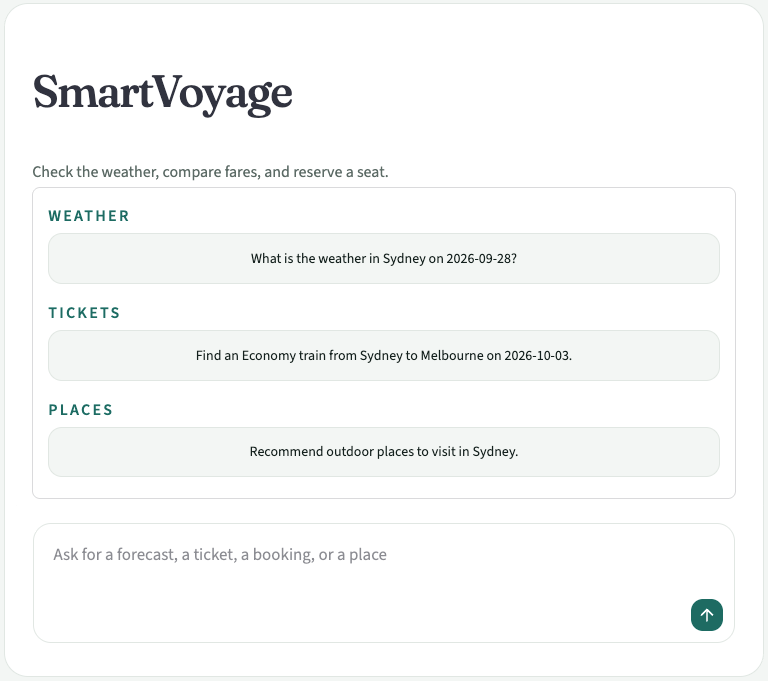
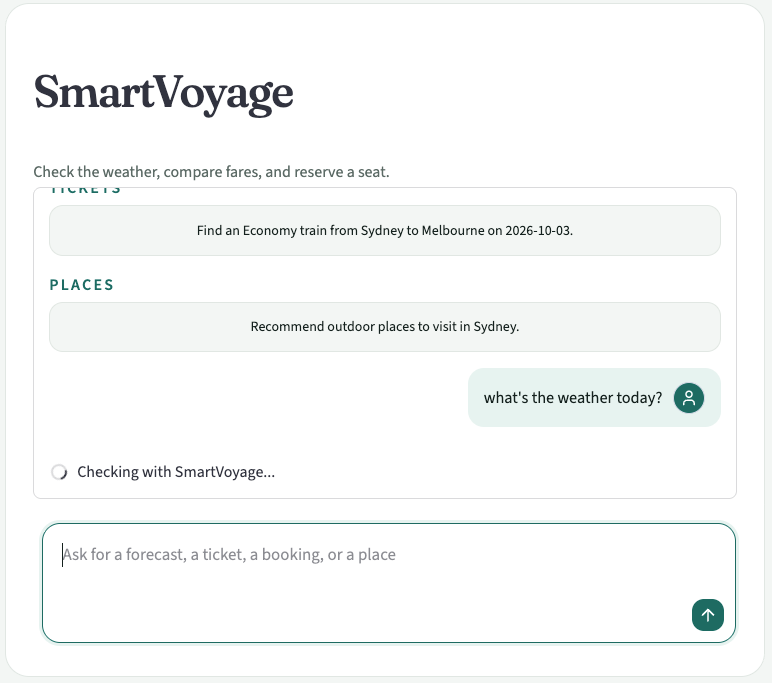
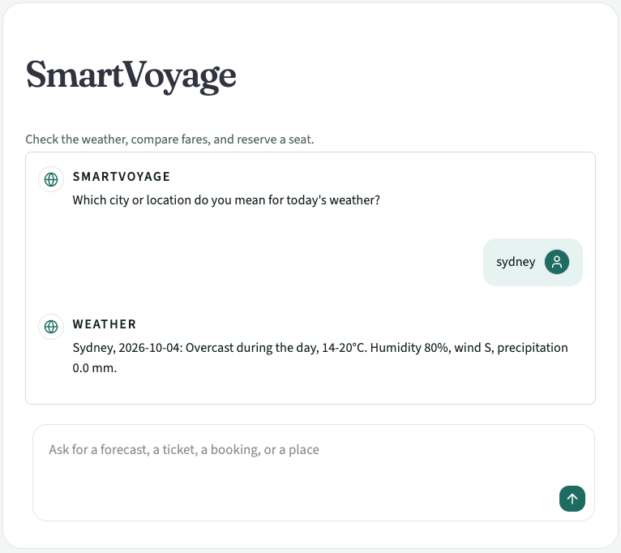
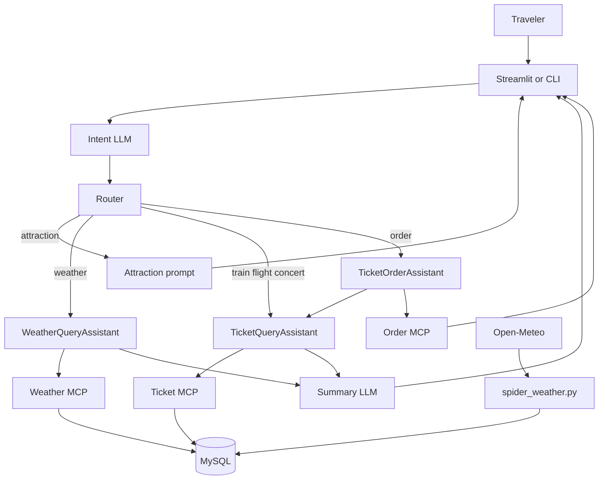
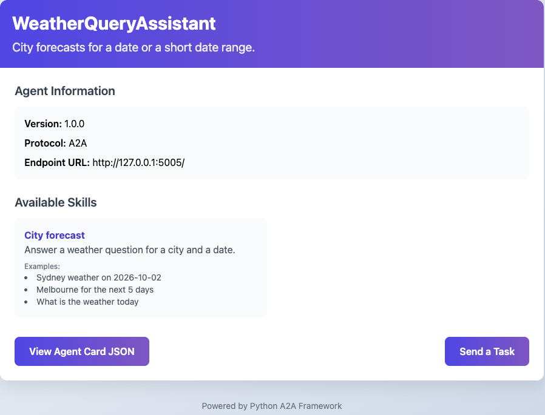
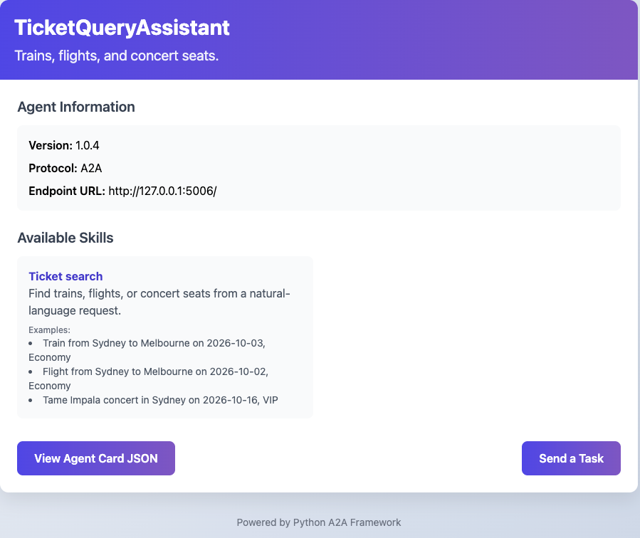
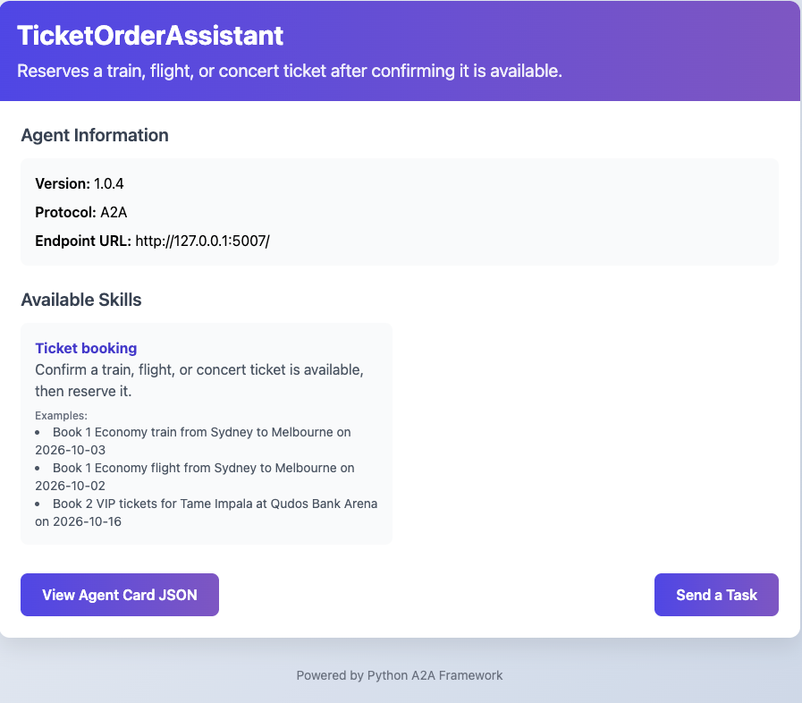

# SmartVoyage

SmartVoyage is a travel assistant for Australian city trips. A traveler asks in plain English for a forecast, a fare, a booking, or a place to visit. The application classifies the request, sends it to the specialist that owns that task, and returns a short answer in the same conversation.

The product surface is a Streamlit chat. The same routing also runs from a command-line loop in `main.py`. Specialists are separate Agent-to-Agent (A2A) services. Weather and ticket lookup read MySQL through Model Context Protocol (MCP) tools. Place suggestions are written by the language model and are not loaded from a table.



The empty screen offers three starters: a Sydney forecast, an Economy train from Sydney to Melbourne, and outdoor places in Sydney. The composer accepts a free-form question.

## Key Features

- **Intent routing.** `app.py` and `main.py` send the latest user turn, a short slice of conversation history, and the current date in Australia/Sydney to an intent prompt. The model returns JSON with `intents`, per-intent `user_queries`, and an optional `follow_up_message`. Recognized intents are `weather`, `train`, `flight`, `concert`, `order`, and `attraction`. Anything else, or a non-empty follow-up, is answered by SmartVoyage without calling a specialist.
- **Weather forecasts.** `WeatherQueryAssistant` turns the conversation into a `SELECT` against `weather_data`, calls the weather MCP tool, and formats city, date, conditions, temperature, humidity, wind, and precipitation. The UI then rewrites that text with the weather summary prompt.
- **Ticket search.** `TicketQueryAssistant` writes a `SELECT` for `train_tickets`, `flight_tickets`, or `concert_tickets`, reads the rows through the ticket MCP tool, and returns one line per option. The UI summarizes those lines with the ticket summary prompt.
- **Ticket booking.** `TicketOrderAssistant` first asks `TicketQueryAssistant` whether the service exists. Only a completed availability task continues. The order agent then uses LangChain tool calling to choose `order_train`, `order_flight`, or `order_concert`. The reply joins the booking confirmation with the availability text.
- **Place suggestions.** An `attraction` intent does not query MySQL. `ATTRACTION_PROMPT` asks the model for planning suggestions, and the UI labels the answer `Places`.
- **Clarifying questions.** If a specialist cannot build a query, it returns A2A state `input_required` with a short question, such as asking which city a forecast is for. The router shows that text instead of inventing a result.
- **Conversation UI.** User messages sit on the right with a traveler icon. Specialist replies sit on the left with a globe icon and a source label (`Weather`, `Tickets`, `Booking`, `Places`, or `SmartVoyage`). The thread keeps a fixed height and scrolls. Starter prompts disappear after the first turn.



A traveler message is aligned to the right while SmartVoyage checks the request.



If the city is missing, SmartVoyage asks for it. The next turn is answered by the weather specialist.

## Architecture

```text
Traveler
    │
    ▼
Streamlit UI (app.py)  or  CLI (main.py)
    │
    │  intent JSON: intents, user_queries, follow_up_message
    ▼
Router
    ├── attraction ──────────────► LLM (ATTRACTION_PROMPT)
    ├── weather ─────────────────► WeatherQueryAssistant     : A2A
    ├── train / flight / concert ► TicketQueryAssistant      : A2A
    └── order ───────────────────► TicketOrderAssistant      : A2A
                                         │
                                         │  availability task
                                         ▼
                                   TicketQueryAssistant
                                         │
                                         ▼
                                   order tool call
                                         │
                                         ▼
                                   Order MCP tools

WeatherQueryAssistant ──SELECT──► Weather MCP ──► MySQL weather_data
TicketQueryAssistant  ──SELECT──► Ticket MCP  ──► MySQL ticket tables

Open-Meteo forecast API ──► utils/spider_weather.py ──► weather_data
```



Each A2A server publishes an agent card: name, description, version, endpoint, and skills. The CLI `cards` command treats an agent as online only when the fetched card name matches the expected assistant name. The chat router calls the agent directly and reports it unavailable when that client is missing.

### WeatherQueryAssistant

Listens on the host and port in `WEATHER_AGENT_URL`. There is no default address.



Skill: **City forecast**. Examples include a dated Sydney forecast, a five-day Melbourne range, and "what is the weather today."

### TicketQueryAssistant

Listens on `TICKET_AGENT_URL`. There is no default address.



Skill: **Ticket search** for trains, flights, and concert seats.

### TicketOrderAssistant

Listens on `ORDER_AGENT_URL`. There is no default address.



Skill: **Ticket booking**. The agent confirms availability with the ticket assistant before it calls a booking tool.

## Technology Stack

| Technology | Why it is here | How this project uses it |
| --- | --- | --- |
| Python | One language for the UI, agents, tools, and data loader | Application modules, MCP servers, A2A servers, and tests |
| Streamlit | Traveler-facing chat without a separate frontend | `app.py` renders the conversation, starter prompts, and composer. Styles live in `css/app.css` |
| python-a2a | Agent-to-agent tasks and tool servers | `A2AServer`, `AgentCard`, `AgentSkill`, `A2AClient`, `AgentNetwork`, and `FastMCP` |
| A2A task protocol | A specialist can finish, ask for more input, or fail without the router knowing its SQL | Clients send a `Task` whose message is `TextContent`. Results are read from `artifacts` or `status.message` |
| LangChain | Prompt chains and tool calling | `ChatPromptTemplate`, `ChatOpenAI`, and `bind_tools` on the order agent |
| OpenAI-compatible chat API | The same client can target OpenAI or another endpoint | `LLM_MODEL`, `OPENAI_API_KEY`, and `OPENAI_BASE_URL`. All three are required and have no default |
| FastAPI transport | HTTP tools with a small, explicit API | `FastMCP.run(transport="fastapi")`. Tests call `GET /health`, `GET /tools`, and `POST /tools/{name}` |
| MySQL | Relational forecasts and inventory, queried with generated SQL | `pymysql` against the host, user, password, and database named in `.env` |
| Open-Meteo | Source of city forecasts | `utils/spider_weather.py` requests `https://api.open-meteo.com/v1/forecast` and writes `weather_data` |
| zoneinfo | Travel dates must follow the destination, not the server locale | Intent routing and SQL prompts use `Australia/Sydney`. The weather loader uses the same zone, with UTC+10 if timezone data is missing |

There is no vector database, document index, or embedding pipeline in this repository. The database name `travel_rag` is only the MySQL schema name.

## Technical Implementation

### Intent routing

The intent prompt is stored in `.env` as `INTENT_PROMPT` and compiled with `ChatPromptTemplate`. The router keeps a text transcript and sends only the last six lines plus the new question. It expects JSON. A fenced response has its ```json wrapper removed before `json.loads`.

One user message can carry more than one intent. Each intent is handled in order, and the replies are joined. `user_queries` lets the model rewrite a clause for a single specialist, for example splitting "weather in Sydney and a train to Melbourne" into two queries. If JSON parsing fails, the UI asks the traveler to name a city, a date, and the need. The underlying exception stays in the log.

### Natural language to SQL

Weather and ticket agents do not expose a fixed query form. Each one loads its `CREATE TABLE` script from `scripts/` and passes that schema, the conversation, and today's Sydney date into a SQL prompt (`WEATHER_SQL_PROMPT` or `TICKET_SQL_PROMPT`).

The model may return a `SELECT`, or a JSON object whose status is `input_required`. Code fences are stripped. The agent accepts the statement only when it starts with `SELECT`. Anything else fails with a traveler-facing sentence and does not call MCP. The ticket agent also records whether the statement targets a train, flight, or concert so the formatted line matches that table.

Generated statements are posted as `{"sql": "..."}` to the MCP tool URL. Weather uses `WEATHER_MCP_URL`. Ticket lookup uses `TICKET_QUERY_URL`.

### MCP tool servers

`FastMCP` serves three tool processes:

| Server | Tool | Input | Behavior |
| --- | --- | --- | --- |
| WeatherTools | `query_weather` | `sql` | Runs the statement on `weather_data` and returns JSON `success`, `no_data`, or `error` |
| TicketTools | `query_ticket` | `sql` | Same pattern for the three ticket tables |
| OrderTools | `order_train`, `order_flight`, `order_concert` | date, service identifier, seat type, quantity | Logs the request and returns a fixed success sentence |

Dates, datetimes, timedeltas, and decimals are converted with `utils/format.py` before the JSON response, because `pymysql` returns those Python types.

The weather and ticket tool processes do not open an HTTP port from their `__main__` blocks. Those blocks only run a sample `SELECT`. HTTP starts from `create_weather_mcp_server()` and `create_ticket_mcp_server()`. The order process does start HTTP from `__main__`.

Tests read the tool and agent addresses from `.env`. A missing URL raises before the test sends a request.

### Booking

`TicketOrderAssistant` is the only specialist that calls another specialist. It sends the same conversation to `TicketQueryAssistant`. A non-completed availability task, including `input_required`, is returned to the traveler unchanged. A completed task is appended to the user text and passed to the order model with `ORDER_SYSTEM_PROMPT` and three LangChain tools. The model must emit a tool call. If it only replies with text, that text is treated as a request for missing details.

`order_train`, `order_flight`, and `order_concert` do not update `remaining_seats`. They return `Train ticket booked successfully.`, `Flight ticket booked successfully.`, or `Concert ticket booked successfully.` The agent then shows that sentence together with the availability text from the ticket agent.

### Weather ingestion

`utils/spider_weather.py` loads forecasts for Sydney, Melbourne, Brisbane, Canberra, Newcastle, Wollongong, Katoomba, Bathurst, and the Gold Coast. It requests 16 days of hourly data, aggregates each local day, and upserts `weather_data` on `(city, fx_date)` with `ON DUPLICATE KEY UPDATE`. A city is skipped when its latest `update_time` is less than 24 hours old. Running the script without `--schedule` forces a refresh. `--schedule` runs one update and then repeats daily at 01:00 Australia/Sydney.

### Conversation state and failure handling

The UI stores messages and a plain-text history in `st.session_state`. Specialist calls use `A2AClient(..., timeout=120)` and `send_task_async`. After a reply, the script reruns so the new turn is drawn inside the scrolling transcript.

User-facing failures do not include SQL, MCP URLs, or exception text. Those details are written by the `SmartVoyage` logger to the console at INFO and to `logs/app.log` at DEBUG. MCP call failures become the JSON message "This service is temporarily unavailable. Please try again."

### Configuration boundary

Prompts, service URLs, the model name, the API key, and the database password are read from `.env`. `.env` is gitignored. `config.py` parses multiline double-quoted values so a prompt can span lines. `require_setting` stops a server at startup when a required prompt or URL is empty, so a clone without `.env` cannot run the agents.

## Project Structure

```text
Smart-Voyage/
├── app.py                  Streamlit chat and router
├── main.py                 Command-line router
├── main_prompts.py         Prompt templates loaded from .env
├── config.py               Environment loading and settings
├── create_logger.py        Console and file logging
├── css/app.css             Chat layout and theme
├── a2a_server/
│   ├── common.py           Shared LLM, MCP call, and task helpers
│   ├── weather_server.py   WeatherQueryAssistant
│   ├── ticket_server.py    TicketQueryAssistant
│   └── order_server.py     TicketOrderAssistant
├── mcp_server/
│   ├── mcp_weather_server.py
│   ├── mcp_ticket_server.py
│   └── mcp_order_server.py
├── scripts/
│   ├── weather_schema.sql
│   ├── ticket_schema.sql
│   ├── insert.sql          Sample Sydney-based rows
│   └── sql_data.sql
├── utils/
│   ├── spider_weather.py   Open-Meteo loader
│   └── format.py           JSON encoding for SQL values
├── test/                   Scripted checks against running services
└── images/                 UI and agent-card screenshots
```

## Data Model

`weather_data` stores one forecast row per city and date: temperatures, day and night descriptions, wind, precipitation, humidity, pressure, visibility, cloud cover, and moon data. The unique key is `(city, fx_date)`.

Ticket inventory is three tables:

- `train_tickets` — route, times, train number, seat type, seats, AUD price
- `flight_tickets` — route, times, flight number, cabin, seats, and AUD price
- `concert_tickets` — artist, city, venue, ticket type, seats, and price

`scripts/insert.sql` loads sample rows for a traveler based in Sydney, including train `ST21`, flight `QF401`, and a Tame Impala concert at Qudos Bank Arena. Prices are AUD.

## Installation

Prerequisites: Python 3.11, MySQL, and an OpenAI-compatible API key.

```bash
pip install streamlit langchain-openai langchain-core python-a2a pymysql requests openai
```

`scripts/sql_data.sql` drops and recreates the `travel_rag` database, then creates the weather and ticket tables. The agents do not execute that file. They load `scripts/weather_schema.sql` and `scripts/ticket_schema.sql` only as schema text for SQL generation. To create the tables and sample rows:

```bash
mysql -u root -p < scripts/sql_data.sql
mysql -u root -p < scripts/insert.sql
```

`insert.sql` selects `travel_rag`. Point `MYSQL_DATABASE` at that schema, or edit the `USE` statement to match your database. If the tables already exist, the split schema files can be applied on their own: `weather_schema.sql` has no `USE`, and `ticket_schema.sql` expects the target database to be selected.

Optional forecast load:

```bash
python utils/spider_weather.py
```

## Configuration

Create a gitignored `.env` in the project root. Names below are the ones the code reads.

| Variable | Used for |
| --- | --- |
| `OPENAI_API_KEY` or `API_KEY` | LLM client. Required |
| `OPENAI_BASE_URL` or `BASE_URL` | Chat API base URL. Required |
| `LLM_MODEL` or `MODEL_NAME` | Chat model. Required |
| `MYSQL_HOST`, `MYSQL_USER`, `MYSQL_PASSWORD`, `MYSQL_DATABASE` | Forecast and ticket database. Required |
| `LOG_FILE` | Optional log path |
| `WEATHER_MCP_URL` | Full URL of `POST /tools/query_weather` |
| `WEATHER_AGENT_URL` | Weather A2A server, including host and port |
| `TICKET_MCP_URL` | Ticket MCP listen address |
| `TICKET_QUERY_URL` | Full URL of `POST /tools/query_ticket` |
| `TICKET_AGENT_URL` | Ticket A2A server, including host and port |
| `ORDER_MCP_URL` | Order MCP listen address |
| `ORDER_AGENT_URL` | Order A2A server, including host and port |
| `WEATHER_SQL_PROMPT`, `TICKET_SQL_PROMPT`, `ORDER_SYSTEM_PROMPT` | Specialist prompts |
| `INTENT_PROMPT`, `SUMMARIZE_WEATHER_PROMPT`, `SUMMARIZE_TICKET_PROMPT`, `ATTRACTION_PROMPT` | Router and UI prompts |
| `TICKET_SUMMARY_PROMPT` | Summary prompt used by `test/test_ticket_agent_server.py` |
| `WEATHER_TEST_SUMMARY_PROMPT` | Summary prompt used by `test/test_weather_agent_server.py` |

Prompt text, the API key, the database password, and every service URL live only in `.env`. None of those settings has a fallback in code. A missing value raises `Missing <NAME>. Add it to the .env file.` before the UI, an agent, or a test can run.

## Usage

Start the tool servers before the agents. From `mcp_server/`:

```bash
python -c "from mcp_weather_server import create_weather_mcp_server; create_weather_mcp_server()"
python -c "from mcp_ticket_server import create_ticket_mcp_server; create_ticket_mcp_server()"
python mcp_order_server.py
```

Start the specialists from the project root:

```bash
python a2a_server/weather_server.py
python a2a_server/ticket_server.py
python a2a_server/order_server.py
```

Start the chat UI:

```bash
streamlit run app.py
```

Or the terminal assistant:

```bash
python main.py
python main.py "What is the weather in Sydney on 2026-09-28?"
```

In the terminal loop, `cards` prints each agent card and `quit` exits.

A running tool server answers `GET /health` and `GET /tools` on the host and port from its `.env` URL. `GET /` is not the health check.

Agent cards are served by each A2A process. The weather, ticket, and order screenshots in this README are those card pages.

## Testing

The checks are executable scripts. They expect the matching service to be running and `.env` to be present. Agent tests also call the chat API to summarize a live response.

```bash
python test/test_weather_mcp_server.py
python test/test_ticket_map_server.py
python test/test_order_mcp_server.py
python test/test_weather_agent_server.py
python test/test_ticket_agent_server.py
python test/test_order_agent_server.py
python main_prompts.py
```

`main_prompts.py` only checks that the four router prompts format without an empty message. It does not call a model.

Weather coverage uses Sydney on `2026-09-28`. Ticket coverage uses Sydney–Melbourne train and flight rows and a Sydney concert. The order-agent test looks for the exact booking sentence returned by the order tool, plus Sydney in the availability text.

## Engineering Achievements

- Routed one conversation across three specialist agents and a direct LLM path, with multi-intent requests split into separate tasks.
- Kept SQL generation inside the specialist that owns the schema, and refused to call MCP unless the generated statement is a `SELECT`.
- Used A2A task states so a missing city or date becomes a follow-up question instead of an empty result.
- Chained agents for booking: the order agent will not call a booking tool until the ticket agent completes an availability task.
- Separated traveler-facing copy from operational logs, so SQL, URLs, and exception strings stay out of the chat.
- Loaded prompts and endpoints from `.env`, so the routing policy is not committed with the code.
- Built a forecast pipeline that aggregates Open-Meteo hours into the same daily rows the weather agent queries.

## Limitations

- Booking tools do not write to MySQL. Seat counts in the sample data do not change after a successful booking message.
- The MCP query tools execute the SQL string they receive. The `SELECT` check is in the weather and ticket agents, not in the database session.
- Place suggestions are model output. They are not retrieved from a places table or a search index.
- Agent cards set `streaming` and `memory` to true. The UI and CLI wait for the finished task and keep their own transcript; they do not render a token stream from the agent.
